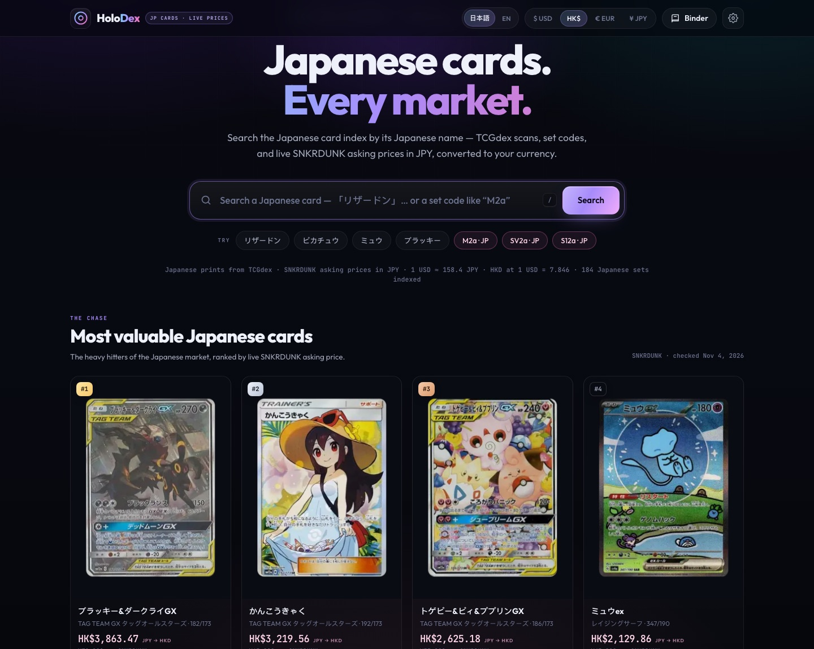
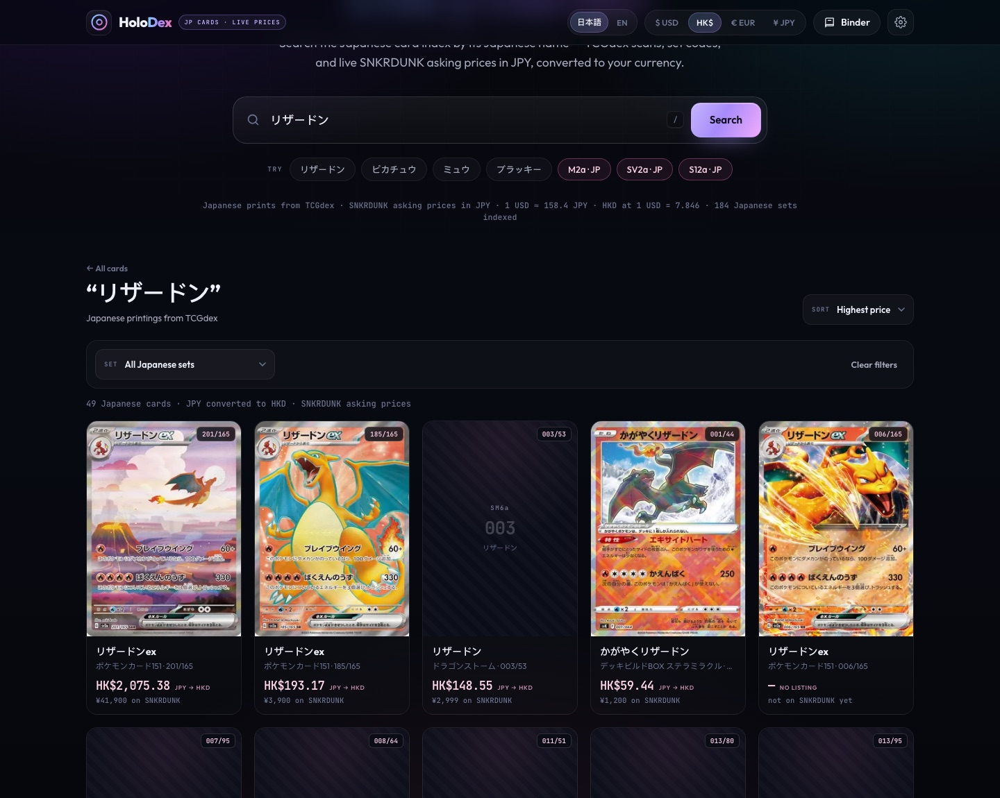
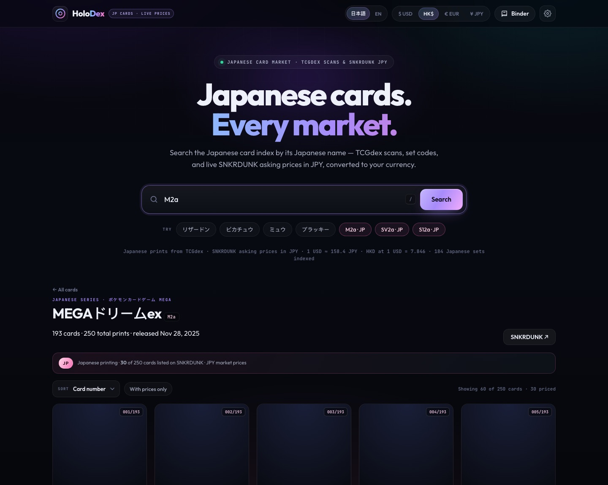
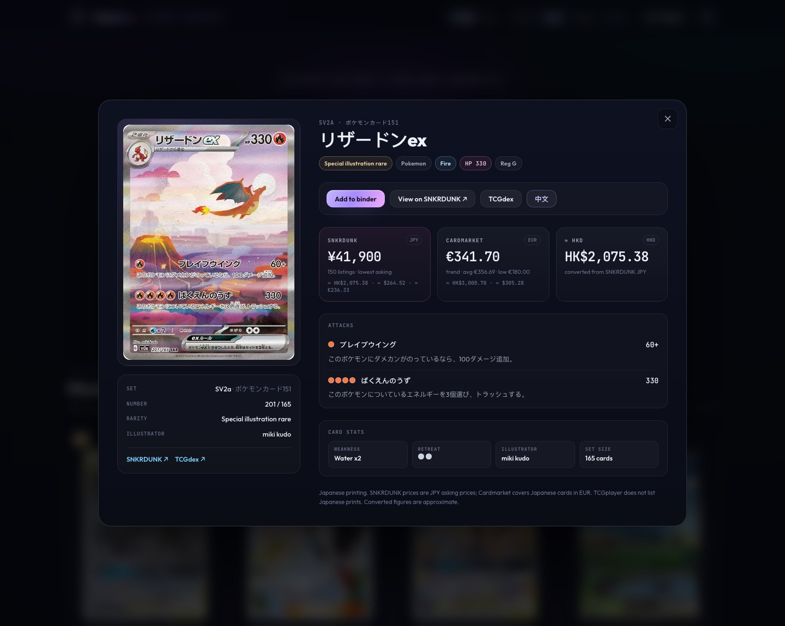
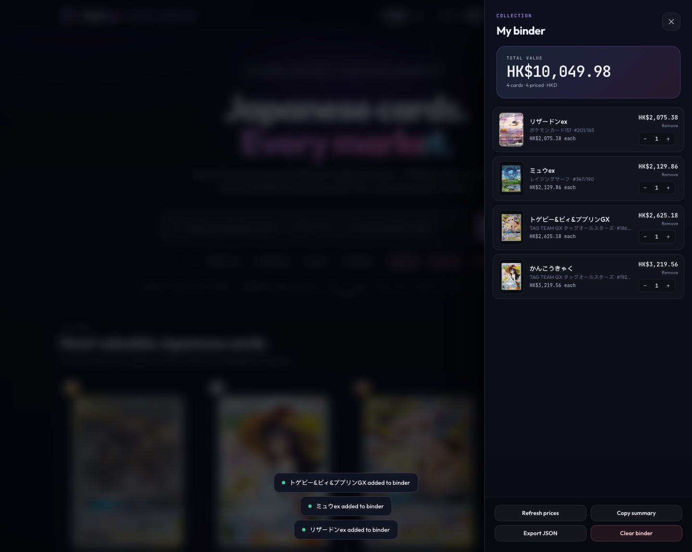
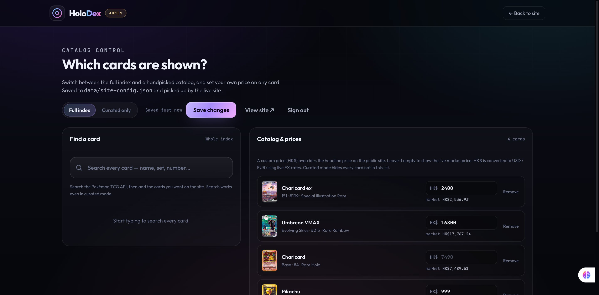
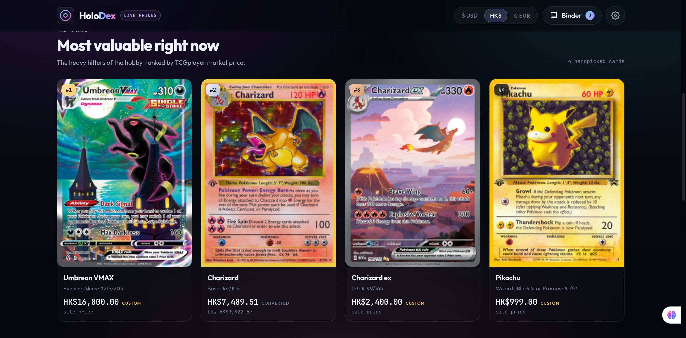
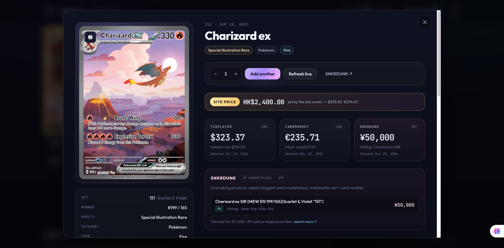

# HoloDex

A local-first **Japanese** Pokémon card price checker with a password-protected
admin panel. Every card the storefront displays is a Japanese printing: Japanese
name, Japanese scan (TCGdex), local set code and card number, and live
**SNKRDUNK** asking prices in **JPY** — shown as yen or converted to
**USD / HKD / EUR**. Browse whole Japanese series by set code (`M2a`, `SV2a`,
`S12a`…), open any card for its Japanese attacks, abilities and flavour text, and
track what your binder is worth.

English cards are still there — flip the **EN** button in the header (or open
`?lang=en`) and the original TCGplayer/Cardmarket index comes back. Japanese is
the default.

No account, no build step, no tracking, no npm dependencies. A folder and Node.

```
HoloDex · Japanese index
  Search   「リザードン」 · 「ピカチュウ」 · 「ミュウ」 · set code M2a
  #1  ブラッキー&ダークライGX   ¥78,000
  #2  かんこうきゃく            ¥65,000
  #3  トゲピー&ピィ&ププリンGX   ¥53,000
  #4  ミュウex                  ¥43,000
```

## Run it

```bash
cd pokemon
node server.mjs
# site   → http://localhost:4310
# admin  → http://localhost:4310/admin
```

Node 18+. Zero npm dependencies — nothing to install.

Port busy? `PORT=8080 node server.mjs`
Raise the card API limit: `POKEMONTCG_API_KEY=xxxx node server.mjs`
Override the admin login: `ADMIN_USER=... ADMIN_PASS=... node server.mjs`

### Prefer no server at all?

The storefront is a plain static app. Open `index.html` directly (or serve the
folder with `python3 -m http.server`) and it works — you just lose server-side
caching, the SNKRDUNK market panel, the admin panel, and live FX (HKD falls back
to baked-in rates). In static mode it talks straight to the public Pokémon TCG API.

## What's inside

| Feature | Details |
| --- | --- |
| **Search (日本語)** | Search the Japanese index by Japanese name (`リザードン`, `ピカチュウ`, `ミュウex`…). Results are Japanese printings with Japanese names, set code + local card number, and SNKRDUNK JPY prices where a listing exists. Sort by price, card number or name. |
| **Japanese sets** | Type a set code like `M2a` (or tap one in **Browse Japanese sets**) to open the whole print run: Japanese names/numbers, TCGdex scans, SNKRDUNK JPY prices, sortable, “with prices only” toggle. |
| **Prices** | SNKRDUNK asking prices in JPY are the headline for Japanese cards. English mode keeps TCGplayer market/low/mid/high per printing plus Cardmarket trend, average, low and 1d/7d/30d averages. |
| **Currencies** | `¥ JPY` (default), `$ USD`, `HK$ HKD`, `€ EUR`. JPY converts through the live USD cross-rate (cached 6h, fallback baked in). Sorting, totals and binder follow the active currency. |
| **Card detail (日本語)** | Japanese name, HP, type, rarity, illustrator, regulation mark, attacks, abilities, weaknesses, retreat, flavour text — plus SNKRDUNK JPY, Cardmarket EUR and an approximate HKD figure. |
| **中文 translation** | Any Japanese card detail has a **中文** button that translates the Japanese name, attacks, abilities and flavour text into Chinese (Simplified or Traditional). Batched through `/api/translate` and cached on disk. |
| **Language toggle** | `日本語` / `EN` in the header. Japanese is the default storefront; `EN` (or `?lang=en`) restores the English TCGplayer/Cardmarket index. The choice is remembered. |
| **Admin panel** | Sign in, switch between the full English index and a curated catalog, add/remove cards, and override any card's price in HK$. Applies to **English mode**; the Japanese storefront is the full TCGdex index. Persisted to disk. |
| **Binder** | Add Japanese cards with quantities, stored in `localStorage`. Running total in the active currency (JPY by default), refresh prices, copy a text summary, export JSON. |
| **Shareable URLs** | `?q=リザードン`, `?jp=M2a`, `?lang=en` — reload restores the view. |
| **Resilience** | Upstreams are flaky; browser + proxy retry with backoff, cache responses, and serve stale data rather than errors. TCGdex has no scan for some older printings — those tiles fall back to a designed placeholder with the set code, number and Japanese name. |

## Card language

The storefront is **Japanese-first**. Everything that renders a card — the home
rail, search results, set pages, the card modal, the binder — uses the Japanese
printing:

- Japanese name, Japanese scan (when TCGdex has one), local set code + card number.
- SNKRDUNK asking prices in JPY, with a one-line conversion into USD / HKD / EUR.
- Japanese attacks, abilities, weaknesses, retreat cost and flavour text.

Switch to **EN** in the header (or open `?lang=en`) and the app flips back to the
original English TCGplayer/Cardmarket index, English filters and English sort
modes. The choice is stored in `localStorage` (`holodex.prefs.cardLang`). Without
the local server there is no Japanese data, so the toggle hides and the app runs
in English/direct-API mode.

Japanese data comes from two places, both proxied and cached by `server.mjs`:

| Source | Used for |
| --- | --- |
| [TCGdex](https://tcgdex.dev) `api.tcgdex.net/v2/ja` | Japanese card names, scans, set metadata, attacks/abilities, Cardmarket EUR pricing for JP printings |
| [SNKRDUNK](https://snkrdunk.com) | Live Japanese asking prices (JPY) matched by set code + card number, plus product images for featured cards |

## Admin panel

Open **<http://localhost:4310/admin>**.

Default credentials (change them with `ADMIN_USER` / `ADMIN_PASS`):

```
username: skibiditoilet577
password: ilikemen123
```

The password is only ever sent to the local server — it never appears in the page
source. A successful sign-in returns a 24-hour session token stored in
`sessionStorage`. The server binds to `127.0.0.1` by default; don't expose it to
the internet as-is.

What you can do:

- **Full index / Curated only** — the mode switch at the top. Curated mode hides
  every card that isn't in the catalog. Full index mode shows everything but still
  applies your price overrides. Both apply to **English mode** — the Japanese
  storefront always shows the full TCGdex index.
- **Find a card** — search the entire Pokémon TCG index and hit *Add*.
- **Custom price (HK$)** — overrides the headline price for that card everywhere
  on the site (tiles, search sorting, binder totals, card modal). Clear the field
  to go back to the live market price. The card modal keeps showing the raw
  TCGplayer / Cardmarket / SNKRDUNK tables and badges the custom price as
  *SITE PRICE*.
- **Save changes** — persists `data/site-config.json`. The storefront picks it up
  on reload, on window focus, and on a 45-second poll (a mode change triggers a
  reload automatically).

The config file is deliberately boring:

```json
{
  "mode": "all",
  "cards": [
    { "id": "swsh7-215", "priceHKD": 16800, "addedAt": "2026-10-29T03:18:36.031Z" },
    { "id": "base1-4", "priceHKD": null, "addedAt": "2026-10-29T03:18:36.031Z" }
  ],
  "updatedAt": "2026-10-29T03:18:36.031Z"
}
```

`priceHKD: null` means “use the market price”. Run the server, edit the file by
hand, restart — same thing.

## FX and display currencies

Japanese cards are priced in JPY (SNKRDUNK asking prices); English cards arrive in
USD (TCGplayer) and EUR (Cardmarket). **JPY, HKD and EUR are display
conversions** at a live rate fetched by `/api/fx` (`open.er-api.com`, falling back
to the jsDelivr currency API, then to baked-in values `7.8 HKD/USD`, `8.7 HKD/EUR`,
`150 JPY/USD`). Admin price overrides are stored in HKD and converted to the other
currencies for those display modes. Rates are cached for six hours; the hero note
shows the rates currently in use.

## Japanese set codes

Japanese sets use codes like `M2a`, `SV2a`, `S12a`, `M2`, `S-P`. Three ways in:

- **Search:** type the code into the main search box — `M2a` opens
  *MEGAドリームex*, `SV2a` opens *ポケモンカード151*. Add a term after the code
  to filter inside the set (`M2a ピカチュウ`, `SV2a リザードン`).
- **Home rail:** **Browse Japanese sets** lists the newest sets TCGdex knows
  about — tap one.
- **Filter:** in Japanese mode the Set dropdown lists every Japanese set (184 and
  counting); in English mode they appear as the **Japanese series (JP)** group.

The series page shows the complete TCGdex card list for that set — Japanese
names, local card numbers, TCGdex card images, and the release date/series.
Cards that are currently listed on SNKRDUNK also get their lowest asking price in
JPY (usually 20–40 cards per set, because SNKRDUNK only lists what sellers have
up). You can sort by card number / price / name and toggle **With prices only**.
Deep links work: `http://localhost:4310/?jp=M2a`.

Clicking a card opens the Japanese card modal: TCGdex attacks/abilities in
Japanese, HP/types/rarity/illustrator, **Cardmarket EUR** prices for the Japanese
printing (TCGdex pricing), **SNKRDUNK JPY** price + listing count, and an
approximate **HKD** conversion. TCGplayer doesn't list Japanese prints, so it's
absent there on purpose.

New MEGA-era sets (`M2a`, `M1L`…) don't have TCGdex card scans yet, so cards
without a SNKRDUNK listing show a designed placeholder with the card number and
name instead of art. Everything else still renders.

This feature needs the local server (it talks to TCGdex and SNKRDUNK server-side
and caches the results in `.cache/`).

## Chinese translation (Japanese cards)

Open any Japanese card — a search result, a set page, or `?jp=M2a` — and hit
**中文** in its action row. The Japanese card name, attack and ability names/text, and flavour text
each get a Chinese line underneath — the Japanese stays put. English card
details are intentionally left untranslated. The toggle is remembered between
visits, and the variant lives in **settings**:

- **简体中文** (`zh-CN`) — the default.
- **繁體中文** (`zh-TW`).

Translations go through the local server: it calls Google's public translate
endpoint once per unique string and caches the result in `.cache/translate/` for
90 days, so reopening the same card is instant. The browser never talks to
Google directly, and nothing beyond the card text is sent. Card names and game
terms are machine translations — useful hints, not official localised text.

This feature needs the local server (run `node server.mjs`) — the Japanese
series view already does. The endpoint also accepts English as a source, so the
helper works for either language:

```js
PDXApi.translate('ピカチュウ', { from: 'ja' }).then(console.log)  // → "皮卡丘"
PDXApi.translateTexts(['ブレイブウイング'], { from: 'ja', to: 'zh-TW' })
  .then(console.log)                                              // → [zh-TW string]
```

## Screenshots

The storefront shots are the default Japanese mode; the admin/curated/custom-price
shots are English mode.

| Japanese storefront (HKD) | Japanese search |
| --- | --- |
|  |  |

| Japanese series | Japanese card detail |
| --- | --- |
|  |  |

| Binder (JPY → HKD) |
| --- |
|  |

| Admin panel (EN mode) | Curated catalog (EN mode) |
| --- | --- |
|  |  |

| Card detail with custom price (EN mode) |
| --- |
|  |

## Files

```
index.html        storefront markup (Japanese-first copy + language toggle)
admin.html        admin panel markup
config.js         static fallback config (direct API mode)
css/styles.css    the whole theme — holo gradients, dark glass, responsive, admin, JP rails
js/api.js         card clients: Pokémon TCG + TCGdex JA search/featured, retry/cache,
                  JPY/USD/HKD/EUR price + FX normalisation, SNKRDUNK, JA→ZH translation
js/store.js       localStorage: prefs (currency, card language, Chinese variant), binder
                  (English + Japanese entries), last-seen price snapshots
js/app.js         storefront controller: JP-first home, Japanese search, set pages, card
                  modal, binder, language + currency switching, curated/English mode
js/admin.js       admin controller: auth, card search, catalog, price editing
server.mjs        static server + cached API proxy + SNKRDUNK + TCGdex JA search/featured/sets
                  + admin API + FX + translation
data/site-config.json   curated catalog + price overrides (created on first save)
.cache/           upstream response cache (git-ignored)
```

## Server endpoints

| Endpoint | Purpose |
| --- | --- |
| `GET /api/v2/*` | Cached Pokémon TCG API proxy (English mode; retries + stale fallback). |
| `GET /api/snkrdunk/card?…` | Match an English card on SNKRDUNK and return JPY listings. |
| `GET /api/jp/cards?q=リザードン&page=1` | **Japanese card search** — TCGdex JA index by Japanese name, with set name/code, local number, scan URL and best-effort SNKRDUNK JPY price. |
| `GET /api/jp/featured` | **Most valuable Japanese cards right now** — the hot-set watchlist merged and ranked by SNKRDUNK price (used by the home rail). |
| `GET /api/jp/sets` | List of Japanese sets (code, name, card count) from TCGdex. |
| `GET /api/jp/set?code=M2a` | Japanese set metadata + every card + SNKRDUNK prices. |
| `GET /api/jp/card?id=M2a-223` | Full Japanese card detail + Cardmarket EUR + SNKRDUNK JPY. |
| `GET /api/fx` | USD → HKD/EUR reference rates (cached). |
| `GET/POST /api/translate` | Japanese (or English) → Chinese translation. `GET ?text=…&from=ja&to=zh-CN` for one string, `POST { texts: [...], from: "ja", to: "zh-CN" \| "zh-TW" }` for a batch. Cached on disk. |
| `GET /api/site-config` | Public mode + price overrides. |
| `GET /api/site-cards` | Full card objects for the curated catalog. |
| `POST /api/admin/login` | Sign in (JSON credentials) → bearer token. |
| `GET/PUT /api/admin/config` | Read / save the catalog config (auth required). |
| `POST /api/admin/logout` | Invalidate the current admin token. |

## Notes / caveats

- Prices are marketplace estimates, not offers. Markets refresh at different rates.
- SNKRDUNK prices are JPY before shipping/fees and refer to their own listings.
- Japanese search, set pages and featured prices need the local server; without it
  the app runs in English/direct-API mode.
- Some Japanese printings have no scan on TCGdex yet (older promos, the newest MEGA
  sets). Those tiles show a designed placeholder with the set code, card number and
  Japanese name instead of art.
- English mode and the admin panel/curated catalog are unchanged; the curated
  catalog applies to English mode, while the Japanese storefront is the full
  TCGdex index.
- HKD/JPY/EUR figures are converted, unless a particular card has an admin override.
- Japanese set data comes from TCGdex; JP market prices are SNKRDUNK asking prices
  in JPY. Cardmarket EUR prices for JP printings come through TCGdex. Converted
  HKD/USD figures use the same live FX rates as the rest of the site.
- Scraping SNKRDUNK product pages is fine for a personal local tool, but be nice:
  the server serialises and caches those requests.
- Chinese translations of Japanese card text are machine-generated by Google's
  public endpoint. They are cached aggressively and are not checked by a human;
  official Pokémon localisations may use different terminology.
- This is a fan project. Not affiliated with Nintendo, Creatures, GAME FREAK,
  The Pokémon Company International, TCGplayer, Cardmarket or SNKRDUNK.

## Ideas if you want to take it further

- Price history charts (Cardmarket exposes 1d/7d/30d averages; SNKRDUNK has a
  sales-history page that could be charted).
- CSV import/export for a whole collection.
- A “watchlist” that pings you when a card crosses a price.
- Multiple curated “collections” instead of one catalog.
